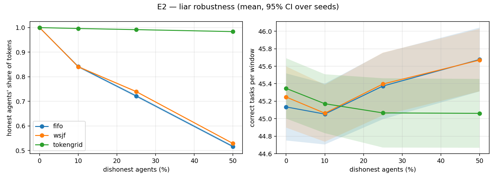
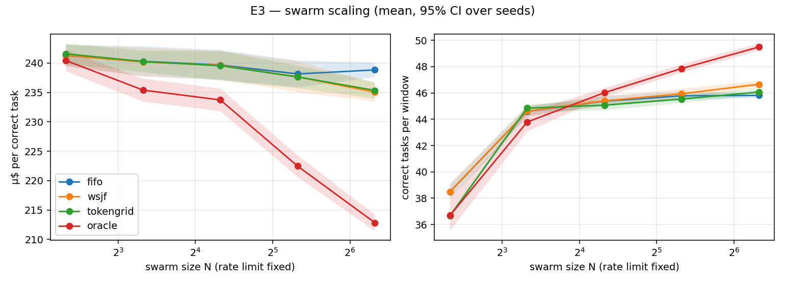
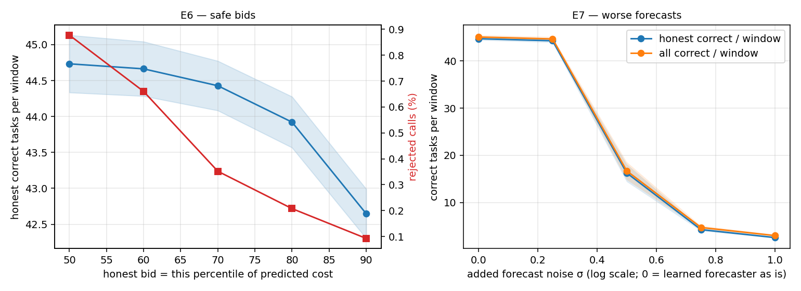

# TokenGrid evaluation

940 traced tasks (arc_challenge: 100, gsm8k: 499, mmlu: 341) · model accuracy 91.8% · mean 434 tokens/task (CV 0.50) · 20 seeds × 300 rounds · rate limit 21,719 tokens / 10-round window · 25% dishonest agents unless varied

## Forecast: can an honest agent predict its own cost?

Cross-fitted. 'Bonus' / 'penalty' = share of honest calls the reputation ledger would reward (accuracy > 0.85) or punish (< 0.4).

| forecaster | Spearman | MAE (tokens) | mean ledger accuracy | bonus | penalty |
|---|---|---|---|---|---|
| learned | 0.62 | 106 | 0.81 | 44.6% | 1.3% |
| constant | -0.03 | 142 | 0.75 | 30.2% | 1.6% |

## E1 — policy comparison (N=20)

Mean [95% CI] over seeds.

| policy | correct / window | honest correct / window | µ$ / correct | rate-limit used | 429 rate | wait p95 (rounds) | honest token share | size bias | honest dropped | liars dropped |
|---|---|---|---|---|---|---|---|---|---|---|
| fifo | 45.4 [45.0, 45.8] | 32.8 [32.5, 33.1] | 239.7 [237.1, 242.2] | 0.987 [0.987, 0.988] | 0.009 [0.008, 0.011] | 8.000 | 0.722 [0.716, 0.728] | 1.002 [0.996, 1.008] | 0.000 | 0.000 |
| random | 45.4 [45.1, 45.7] | 32.7 [32.4, 33.0] | 239.5 [237.2, 241.9] | 0.987 [0.986, 0.988] | 0.009 [0.008, 0.011] | 8.650 [8.421, 8.879] | 0.719 [0.713, 0.725] | 1.001 [0.996, 1.007] | 0.000 | 0.000 |
| urgency | 45.4 [45.1, 45.7] | 32.9 [32.4, 33.4] | 239.2 [237.1, 241.4] | 0.987 [0.986, 0.988] | 0.008 [0.007, 0.010] | 9.000 | 0.724 [0.715, 0.733] | 1.001 [0.996, 1.006] | 0.000 | 0.000 |
| wsjf | 45.4 [45.0, 45.8] | 33.6 [33.3, 33.9] | 239.6 [237.2, 242.0] | 0.987 [0.987, 0.988] | 0.008 [0.007, 0.009] | 8.950 [8.845, 9.055] | 0.740 [0.736, 0.743] | 1.002 [0.996, 1.008] | 0.000 | 0.000 |
| tokengrid | 45.1 [44.7, 45.5] | 44.7 [44.3, 45.1] | 239.5 [237.0, 242.0] | 0.980 [0.979, 0.982] | 0.008 [0.007, 0.010] | 8.000 | 0.992 [0.991, 0.993] | 1.002 [0.996, 1.008] | 0.050 [-0.055, 0.155] | 4.950 [4.845, 5.055] |
| oracle | 46.0 [45.7, 46.4] | 34.0 [33.2, 34.8] | 233.7 [231.8, 235.6] | 0.983 [0.981, 0.984] | 0.000 | 8.470 [8.236, 8.704] | 0.736 [0.720, 0.751] | 0.987 [0.983, 0.992] | 0.000 | 0.000 |
| tokengrid (no learned predictor) | 44.7 [44.3, 45.1] | 44.3 [44.0, 44.7] | 240.3 [238.0, 242.6] | 0.975 [0.974, 0.977] | 0.007 [0.006, 0.008] | 8.000 | 0.991 [0.990, 0.993] | 1.004 [0.998, 1.009] | 0.150 [-0.021, 0.321] | 5.000 |
| tokengrid (original 50% rule) | 41.1 [40.8, 41.5] | 40.8 [40.4, 41.1] | 239.5 [236.8, 242.1] | 0.895 [0.893, 0.897] | 0.000 [-0.000, 0.000] | 8.000 | 0.991 [0.990, 0.992] | 1.002 [0.995, 1.008] | 0.050 [-0.055, 0.155] | 4.950 [4.845, 5.055] |

### Paired differences: tokengrid minus …

Same seeds → same agents, liars and task sequences. CI excluding 0 = significant at 5%.

| vs | Δ correct / window | Δ honest correct / window | Δ µ$ / correct |
|---|---|---|---|
| fifo | -0.307 [-0.539, -0.074] | 11.9 [11.6, 12.2] | -0.141 [-1.609, 1.326] |
| random | -0.322 [-0.544, -0.099] | 12.0 [11.7, 12.3] | -0.000 [-1.395, 1.394] |
| urgency | -0.350 [-0.559, -0.141] | 11.8 [11.4, 12.2] | 0.287 [-0.963, 1.536] |
| wsjf | -0.330 [-0.543, -0.117] | 11.1 [10.9, 11.3] | -0.083 [-1.337, 1.170] |
| oracle | -0.952 [-1.236, -0.668] | 10.7 [10.1, 11.3] | 5.815 [4.255, 7.375] |
| tokengrid (no learned predictor) | 0.367 [0.164, 0.569] | 0.382 [0.177, 0.586] | -0.743 [-1.883, 0.397] |
| tokengrid (original 50% rule) | 3.925 [3.755, 4.095] | 3.925 [3.755, 4.095] | 0.058 [-0.654, 0.770] |

## E2 — liar robustness

Honest agents' share of tokens (higher = liars captured less capacity).

| policy | 0% liars | 10% liars | 25% liars | 50% liars |
|---|---|---|---|---|
| fifo | 1.000 | 0.841 [0.836, 0.846] | 0.722 [0.716, 0.728] | 0.516 [0.511, 0.521] |
| wsjf | 1.000 | 0.841 [0.838, 0.844] | 0.740 [0.736, 0.743] | 0.529 [0.526, 0.532] |
| tokengrid | 1.000 | 0.996 [0.996, 0.997] | 0.992 [0.991, 0.993] | 0.984 [0.982, 0.985] |

## E3 — swarm scaling (fixed rate limit)

µ$ per correct task.

| policy | N=5 | N=10 | N=20 | N=40 | N=80 |
|---|---|---|---|---|---|
| fifo | 241.3 [239.4, 243.1] | 240.3 [237.7, 242.8] | 239.7 [237.1, 242.2] | 238.1 [235.9, 240.4] | 238.8 [237.6, 240.1] |
| wsjf | 241.3 [239.5, 243.1] | 240.2 [237.7, 242.6] | 239.6 [237.2, 242.0] | 237.6 [235.0, 240.2] | 235.0 [233.5, 236.6] |
| tokengrid | 241.6 [239.8, 243.3] | 240.3 [238.4, 242.1] | 239.5 [237.0, 242.0] | 237.6 [235.7, 239.5] | 235.3 [233.9, 236.8] |
| oracle | 240.4 [238.6, 242.2] | 235.4 [233.4, 237.3] | 233.7 [231.8, 235.6] | 222.5 [220.6, 224.3] | 212.8 [211.4, 214.2] |

## E4 — the capacity fix

Each round may spend 50% of the remaining window headroom (original rule). Headroom left at the window reset is lost, so the chosen rule `release_at_reset` lets the last round before the reset spend all of it.

### (a) Selection — dev seeds 100–119 (where the rule was chosen; means)

| liars | rule | policy | rate-limit used | correct / window | honest correct / window | 429 rate | honest token share | liars dropped | honest dropped |
|---|---|---|---|---|---|---|---|---|---|
| 25% | original | tokengrid | 0.896 | 41.363 | 40.987 | 0.000 | 0.990 | 4.950 | 0.100 |
| 25% | original | fifo | 0.975 | 45.112 | 33.300 | 0.003 | 0.738 | 0.000 | 0.000 |
| 25% | release_at_reset | tokengrid | 0.980 | 45.162 | 44.785 | 0.008 | 0.991 | 4.950 | 0.100 |
| 25% | release_at_reset | fifo | 0.987 | 45.658 | 33.175 | 0.009 | 0.727 | 0.000 | 0.000 |
| 25% | spend_all | tokengrid | 0.979 | 45.088 | 44.710 | 0.010 | 0.991 | 5.000 | 0.100 |
| 25% | spend_all | fifo | 0.992 | 45.957 | 35.122 | 0.036 | 0.765 | 0.000 | 0.000 |
| 25% | even_pacing | tokengrid | 0.979 | 45.442 | 45.317 | 0.009 | 0.997 | 2.000 | 0.100 |
| 25% | even_pacing | fifo | 0.986 | 45.733 | 28.227 | 0.017 | 0.613 | 0.000 | 0.000 |
| 50% | original | tokengrid | 0.888 | 40.765 | 40.022 | 0.000 | 0.981 | 9.950 | 0.050 |
| 50% | original | fifo | 0.988 | 45.707 | 23.702 | 0.013 | 0.521 | 0.000 | 0.000 |
| 50% | release_at_reset | tokengrid | 0.979 | 45.055 | 44.312 | 0.008 | 0.983 | 9.950 | 0.050 |
| 50% | release_at_reset | fifo | 0.992 | 45.898 | 23.695 | 0.022 | 0.519 | 0.000 | 0.000 |
| 50% | spend_all | tokengrid | 0.975 | 44.810 | 44.063 | 0.008 | 0.983 | 10.000 | 0.050 |
| 50% | spend_all | fifo | 0.994 | 46.045 | 23.948 | 0.062 | 0.523 | 0.000 | 0.000 |
| 50% | even_pacing | tokengrid | 0.977 | 44.988 | 44.658 | 0.008 | 0.993 | 5.000 | 0.050 |
| 50% | even_pacing | fifo | 0.992 | 45.717 | 3.225 | 0.031 | 0.067 | 0.000 | 0.000 |

### (b) Confirmation — evaluation seeds, tokengrid, release_at_reset minus original

Paired by seed. CI excluding 0 = significant at 5%.

| liars | Δ rate-limit used | Δ correct / window | Δ honest correct / window | Δ 429 rate | Δ honest token share | Δ liars dropped | Δ honest dropped |
|---|---|---|---|---|---|---|---|
| 0% | 0.093 [0.091, 0.095] | 4.268 [4.100, 4.437] | 4.268 [4.100, 4.437] | 0.011 [0.010, 0.012] | 0.000 | 0.000 | 0.000 |
| 25% | 0.086 [0.083, 0.089] | 3.925 [3.755, 4.095] | 3.925 [3.755, 4.095] | 0.008 [0.007, 0.010] | 0.001 [0.001, 0.001] | 0.000 | 0.000 |
| 50% | 0.092 [0.091, 0.094] | 4.313 [4.160, 4.467] | 4.313 [4.160, 4.467] | 0.008 [0.007, 0.009] | 0.002 [0.002, 0.002] | 0.000 | 0.000 |

### (c) Held-out tasks — only the 640 tasks collected after the rule was chosen

Evaluation seeds, 25% liars, tokengrid, release_at_reset minus original, paired.

| Δ rate-limit used | Δ correct / window | Δ honest correct / window | Δ 429 rate | Δ honest token share | Δ liars dropped | Δ honest dropped |
|---|---|---|---|---|---|---|
| 0.092 [0.089, 0.095] | 4.110 [3.912, 4.308] | 4.110 [3.912, 4.308] | 0.009 [0.008, 0.010] | 0.001 [0.001, 0.001] | 0.000 | 0.000 |

## E5 — 10 forecasters

Forecast quality (cross-fitted, all tasks). Ledger accuracy = the reputation ledger's own min(pred, actual)/max(pred, actual); rep change / call = bonus × bonus rate − penalty × penalty rate for an honest agent bidding this forecast (below 0 = drifting toward removal, the E7 cliff); coverage = share of tasks that cost no more than forecast.

| forecaster | Spearman | MAE (tokens) | ledger accuracy | bonus | penalty | rep change / call | coverage |
|---|---|---|---|---|---|---|---|
| constant | -0.03 | 142 | 0.747 | 30.2% | 1.6% | +1.19 | 63.1% |
| per-benchmark average | 0.23 | 136 | 0.760 | 33.0% | 1.5% | +1.35 | 62.9% |
| length-only (ridge) | 0.64 | 110 | 0.802 | 39.6% | 1.2% | +1.74 | 66.1% |
| embedding (ridge) | 0.59 | 112 | 0.798 | 40.2% | 1.2% | +1.78 | 61.3% |
| embedding (lgbm) | 0.58 | 111 | 0.801 | 42.9% | 1.2% | +1.91 | 56.7% |
| embedding (lgbm, log-median) | 0.60 | 110 | 0.806 | 43.7% | 1.3% | +1.93 | 51.9% |
| kNN (10 nearest) | 0.36 | 131 | 0.771 | 38.0% | 1.6% | +1.58 | 61.8% |
| exact input + predicted output | 0.62 | 106 | 0.811 | 44.6% | 1.3% | +1.97 | 55.4% |
| ensemble (ridge + lgbm + kNN) | 0.57 | 113 | 0.796 | 40.2% | 1.2% | +1.78 | 60.3% |
| cost buckets (short/med/long) | 0.40 | 131 | 0.772 | 37.8% | 2.2% | +1.44 | 52.8% |

Selection on dev seeds 100–119 by the largest reputation change per honest call (in play): exact input + predicted output +1.98, embedding (lgbm, log-median) +1.95, embedding (lgbm) +1.93, ensemble (ridge + lgbm + kNN) +1.79, embedding (ridge) +1.79, length-only (ridge) +1.75, kNN (10 nearest) +1.61, cost buckets (short/med/long) +1.43, per-benchmark average +1.38 → **primary: exact input + predicted output** (used for E1–E4).

### Distance from the reputation cliff (evaluation seeds, 25% liars, measured in play)

| forecaster | rep change / honest call | honest calls penalized | ledger accuracy (in play) | honest dropped | honest correct / window | 429 rate |
|---|---|---|---|---|---|---|
| constant | 1.174 [1.138, 1.210] | 0.017 [0.015, 0.018] | 0.748 [0.746, 0.750] | 0.150 [-0.021, 0.321] | 44.3 [44.0, 44.7] | 0.007 [0.006, 0.008] |
| per-benchmark average | 1.350 [1.311, 1.389] | 0.015 [0.014, 0.017] | 0.762 [0.760, 0.763] | 0.050 [-0.055, 0.155] | 44.3 [43.9, 44.6] | 0.007 [0.006, 0.008] |
| length-only (ridge) | 1.727 [1.691, 1.762] | 0.012 [0.011, 0.013] | 0.803 [0.801, 0.804] | 0.000 | 44.5 [44.1, 44.9] | 0.005 [0.004, 0.006] |
| embedding (ridge) | 1.777 [1.735, 1.819] | 0.012 [0.011, 0.013] | 0.799 [0.798, 0.801] | 0.100 [-0.109, 0.309] | 44.7 [44.3, 45.0] | 0.006 [0.005, 0.007] |
| embedding (lgbm) | 1.919 [1.885, 1.953] | 0.012 [0.011, 0.013] | 0.801 [0.800, 0.803] | 0.000 | 44.7 [44.3, 45.1] | 0.007 [0.007, 0.008] |
| embedding (lgbm, log-median) | 1.944 [1.906, 1.982] | 0.013 [0.012, 0.014] | 0.806 [0.805, 0.808] | 0.050 [-0.055, 0.155] | 44.8 [44.4, 45.2] | 0.009 [0.008, 0.010] |
| kNN (10 nearest) | 1.578 [1.539, 1.617] | 0.016 [0.015, 0.018] | 0.772 [0.770, 0.773] | 0.100 [-0.044, 0.244] | 44.6 [44.2, 45.0] | 0.007 [0.006, 0.009] |
| exact input + predicted output | 1.964 [1.927, 2.002] | 0.013 [0.012, 0.014] | 0.811 [0.809, 0.812] | 0.050 [-0.055, 0.155] | 44.7 [44.3, 45.1] | 0.008 [0.007, 0.010] |
| ensemble (ridge + lgbm + kNN) | 1.778 [1.744, 1.812] | 0.012 [0.011, 0.013] | 0.797 [0.795, 0.798] | 0.050 [-0.055, 0.155] | 44.7 [44.3, 45.0] | 0.007 [0.006, 0.008] |
| cost buckets (short/med/long) | 1.437 [1.376, 1.497] | 0.023 [0.022, 0.025] | 0.772 [0.769, 0.774] | 0.300 [-0.132, 0.732] | 44.2 [43.8, 44.5] | 0.007 [0.006, 0.009] |
| exact input + predicted output + online per-agent correction | 1.819 [1.781, 1.858] | 0.013 [0.012, 0.014] | 0.799 [0.797, 0.800] | 0.050 [-0.055, 0.155] | 44.7 [44.4, 45.1] | 0.008 [0.007, 0.009] |

### Near-cliff stress test: every forecast given extra noise σ = 0.35 (same noise for all)

More margin from the cliff = fewer honest agents removed when forecasts get worse.

| forecaster | rep change / honest call | honest dropped | honest correct / window |
|---|---|---|---|
| constant | -0.429 [-0.525, -0.334] | 14.0 [13.4, 14.6] | 30.5 [27.1, 33.9] |
| per-benchmark average | -0.304 [-0.383, -0.224] | 13.3 [12.8, 13.9] | 34.6 [31.5, 37.7] |
| length-only (ridge) | 0.472 [0.404, 0.539] | 4.450 [3.426, 5.474] | 43.8 [43.4, 44.2] |
| embedding (ridge) | 0.634 [0.568, 0.700] | 2.900 [2.070, 3.730] | 43.9 [43.5, 44.3] |
| embedding (lgbm) | 0.547 [0.471, 0.623] | 3.300 [2.400, 4.200] | 43.9 [43.6, 44.3] |
| embedding (lgbm, log-median) | 0.538 [0.465, 0.610] | 3.850 [3.219, 4.481] | 44.0 [43.6, 44.4] |
| kNN (10 nearest) | -0.023 [-0.089, 0.043] | 10.2 [9.1, 11.2] | 41.2 [39.3, 43.1] |
| exact input + predicted output | 0.617 [0.533, 0.701] | 3.000 [2.115, 3.885] | 43.9 [43.5, 44.2] |
| ensemble (ridge + lgbm + kNN) | 0.575 [0.500, 0.650] | 3.650 [2.628, 4.672] | 43.9 [43.5, 44.2] |
| cost buckets (short/med/long) | 0.010 [-0.095, 0.114] | 10.0 [8.7, 11.3] | 40.7 [38.3, 43.1] |
| exact input + predicted output + online per-agent correction | 0.297 [0.219, 0.374] | 7.000 [5.948, 8.052] | 43.6 [43.1, 44.0] |

### System results (evaluation seeds, 25% liars). Mean [95% CI].

| forecaster | honest correct / window | correct / window | 429 rate | honest dropped | liars dropped | rate-limit used |
|---|---|---|---|---|---|---|
| constant | 44.3 [44.0, 44.7] | 44.7 [44.3, 45.1] | 0.007 [0.006, 0.008] | 0.150 [-0.021, 0.321] | 5.000 | 0.975 [0.974, 0.977] |
| per-benchmark average | 44.3 [43.9, 44.6] | 44.6 [44.3, 45.0] | 0.007 [0.006, 0.008] | 0.050 [-0.055, 0.155] | 5.000 | 0.973 [0.971, 0.975] |
| length-only (ridge) | 44.5 [44.1, 44.9] | 44.9 [44.5, 45.3] | 0.005 [0.004, 0.006] | 0.000 | 4.900 [4.691, 5.109] | 0.977 [0.975, 0.979] |
| embedding (ridge) | 44.7 [44.3, 45.0] | 45.0 [44.7, 45.4] | 0.006 [0.005, 0.007] | 0.100 [-0.109, 0.309] | 4.950 [4.845, 5.055] | 0.978 [0.977, 0.979] |
| embedding (lgbm) | 44.7 [44.3, 45.1] | 45.1 [44.7, 45.5] | 0.007 [0.007, 0.008] | 0.000 | 4.950 [4.845, 5.055] | 0.980 [0.978, 0.982] |
| embedding (lgbm, log-median) | 44.8 [44.4, 45.2] | 45.1 [44.8, 45.5] | 0.009 [0.008, 0.010] | 0.050 [-0.055, 0.155] | 5.000 | 0.981 [0.980, 0.983] |
| kNN (10 nearest) | 44.6 [44.2, 45.0] | 44.9 [44.6, 45.3] | 0.007 [0.006, 0.009] | 0.100 [-0.044, 0.244] | 4.750 [4.493, 5.007] | 0.977 [0.975, 0.979] |
| exact input + predicted output | 44.7 [44.3, 45.1] | 45.1 [44.7, 45.5] | 0.008 [0.007, 0.010] | 0.050 [-0.055, 0.155] | 4.950 [4.845, 5.055] | 0.980 [0.979, 0.982] |
| ensemble (ridge + lgbm + kNN) | 44.7 [44.3, 45.0] | 45.0 [44.7, 45.4] | 0.007 [0.006, 0.008] | 0.050 [-0.055, 0.155] | 4.950 [4.845, 5.055] | 0.980 [0.979, 0.982] |
| cost buckets (short/med/long) | 44.2 [43.8, 44.5] | 44.5 [44.2, 44.9] | 0.007 [0.006, 0.009] | 0.300 [-0.132, 0.732] | 5.000 | 0.970 [0.968, 0.972] |
| exact input + predicted output + online per-agent correction | 44.7 [44.4, 45.1] | 45.1 [44.7, 45.5] | 0.008 [0.007, 0.009] | 0.050 [-0.055, 0.155] | 4.950 [4.845, 5.055] | 0.981 [0.979, 0.982] |

Paired differences vs. **constant** (CI excluding 0 = significant at 5%):

| forecaster | Δ rep change / honest call | Δ honest correct / window | Δ honest dropped (stress test) |
|---|---|---|---|
| length-only (ridge) | 0.553 [0.515, 0.591] | 0.208 [-0.060, 0.476] | -9.550 [-10.629, -8.471] |
| embedding (ridge) | 0.603 [0.569, 0.638] | 0.350 [0.162, 0.538] | -11.1 [-12.2, -10.0] |
| embedding (lgbm) | 0.745 [0.706, 0.784] | 0.392 [0.158, 0.626] | -10.7 [-11.6, -9.8] |
| embedding (lgbm, log-median) | 0.770 [0.734, 0.805] | 0.445 [0.235, 0.655] | -10.2 [-10.9, -9.4] |
| kNN (10 nearest) | 0.404 [0.370, 0.438] | 0.282 [0.051, 0.513] | -3.850 [-5.048, -2.652] |
| exact input + predicted output | 0.790 [0.752, 0.828] | 0.382 [0.177, 0.586] | -11.0 [-11.8, -10.2] |
| ensemble (ridge + lgbm + kNN) | 0.604 [0.581, 0.628] | 0.357 [0.158, 0.555] | -10.3 [-11.3, -9.4] |
| cost buckets (short/med/long) | 0.263 [0.214, 0.311] | -0.165 [-0.409, 0.079] | -4.000 [-5.166, -2.834] |
| exact input + predicted output + online per-agent correction | 0.645 [0.597, 0.693] | 0.417 [0.163, 0.671] | -7.000 [-7.972, -6.028] |

Paired differences vs. **per-benchmark average** (CI excluding 0 = significant at 5%):

| forecaster | Δ rep change / honest call | Δ honest correct / window | Δ honest dropped (stress test) |
|---|---|---|---|
| length-only (ridge) | 0.377 [0.338, 0.415] | 0.268 [0.055, 0.482] | -8.900 [-9.871, -7.929] |
| embedding (ridge) | 0.427 [0.388, 0.466] | 0.410 [0.237, 0.583] | -10.4 [-11.4, -9.5] |
| embedding (lgbm) | 0.569 [0.528, 0.610] | 0.452 [0.257, 0.646] | -10.1 [-11.0, -9.1] |
| embedding (lgbm, log-median) | 0.594 [0.557, 0.631] | 0.505 [0.351, 0.659] | -9.500 [-10.153, -8.847] |
| kNN (10 nearest) | 0.228 [0.196, 0.259] | 0.342 [0.180, 0.504] | -3.200 [-4.342, -2.058] |
| exact input + predicted output | 0.614 [0.573, 0.655] | 0.442 [0.251, 0.633] | -10.3 [-11.1, -9.6] |
| ensemble (ridge + lgbm + kNN) | 0.428 [0.400, 0.456] | 0.417 [0.246, 0.588] | -9.700 [-10.625, -8.775] |
| cost buckets (short/med/long) | 0.087 [0.047, 0.126] | -0.105 [-0.271, 0.061] | -3.350 [-4.458, -2.242] |
| exact input + predicted output + online per-agent correction | 0.469 [0.422, 0.516] | 0.477 [0.278, 0.675] | -6.350 [-7.252, -5.448] |

## E6 — safe bids (embedding (lgbm))

Honest agents bid the q-th percentile of their predicted cost instead of the average estimate.

| bid | coverage | ledger accuracy | honest correct / window | correct / window | 429 rate | honest dropped | liars dropped | rate-limit used |
|---|---|---|---|---|---|---|---|---|
| average (point) | 56.7% | 0.801 | 44.7 [44.3, 45.1] | 45.1 [44.7, 45.5] | 0.007 [0.007, 0.008] | 0.000 | 4.950 [4.845, 5.055] | 0.980 [0.978, 0.982] |
| 50% percentile | 51.0% | 0.805 | 44.7 [44.3, 45.1] | 45.1 [44.7, 45.5] | 0.009 [0.008, 0.010] | 0.000 | 4.950 [4.845, 5.055] | 0.981 [0.979, 0.982] |
| 60% percentile | 60.5% | 0.797 | 44.7 [44.3, 45.0] | 45.0 [44.6, 45.4] | 0.007 [0.005, 0.008] | 0.000 | 4.950 [4.845, 5.055] | 0.978 [0.977, 0.979] |
| 70% percentile | 70.9% | 0.775 | 44.4 [44.1, 44.8] | 44.8 [44.4, 45.1] | 0.004 [0.003, 0.004] | 0.050 [-0.055, 0.155] | 4.800 [4.608, 4.992] | 0.974 [0.972, 0.975] |
| 80% percentile | 78.5% | 0.740 | 43.9 [43.6, 44.3] | 44.3 [43.9, 44.6] | 0.002 [0.001, 0.003] | 0.050 [-0.055, 0.155] | 4.600 [4.281, 4.919] | 0.963 [0.962, 0.964] |
| 90% percentile | 90.2% | 0.666 | 42.6 [42.3, 43.0] | 43.0 [42.7, 43.3] | 0.001 [0.001, 0.001] | 2.000 [1.256, 2.744] | 4.100 [3.701, 4.499] | 0.938 [0.936, 0.940] |

## E7 — forecast noise (exact input + predicted output)

Forecasts multiplied by exp(σ·z), z ~ N(0,1) fixed per task: σ = 0 is the learned forecaster as is.

| σ | Spearman | ledger accuracy | penalty | honest correct / window | correct / window | 429 rate | honest dropped | liars dropped | rate-limit used |
|---|---|---|---|---|---|---|---|---|---|
| 0 | 0.62 | 0.811 | 1.3% | 44.7 [44.3, 45.1] | 45.1 [44.7, 45.5] | 0.008 [0.007, 0.010] | 0.050 [-0.055, 0.155] | 4.950 [4.845, 5.055] | 0.980 [0.979, 0.982] |
| 0.25 | 0.44 | 0.765 | 2.9% | 44.3 [43.8, 44.7] | 44.7 [44.2, 45.1] | 0.007 [0.006, 0.008] | 0.550 [0.267, 0.833] | 4.750 [4.542, 4.958] | 0.973 [0.971, 0.976] |
| 0.5 | 0.29 | 0.676 | 10.6% | 16.3 [14.4, 18.1] | 16.7 [14.8, 18.6] | 0.002 [0.001, 0.002] | 14.9 [14.8, 15.1] | 5.000 | 0.362 [0.322, 0.402] |
| 0.75 | 0.21 | 0.591 | 23.1% | 4.258 [3.924, 4.593] | 4.715 [4.368, 5.062] | 0.001 [-0.001, 0.002] | 15.0 | 4.700 [4.480, 4.920] | 0.103 [0.094, 0.111] |
| 1 | 0.17 | 0.518 | 35.9% | 2.567 [2.392, 2.742] | 2.992 [2.806, 3.177] | 0.001 [-0.001, 0.003] | 14.6 [14.2, 15.0] | 3.950 [3.483, 4.417] | 0.065 [0.061, 0.069] |

