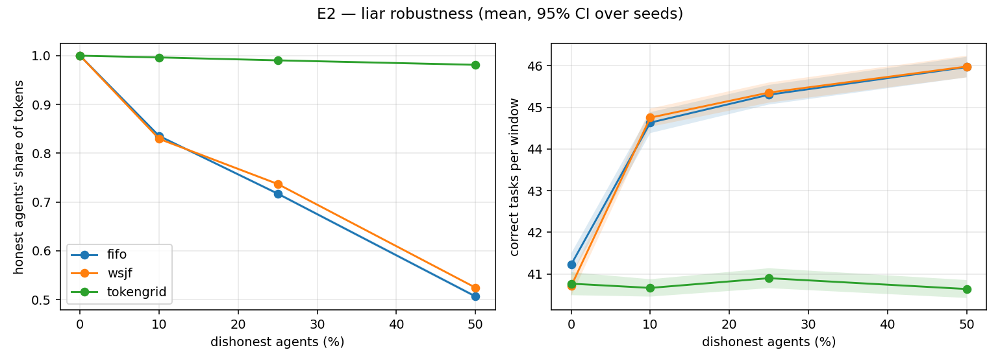
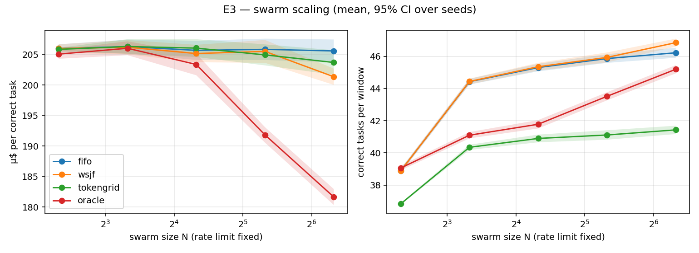

# TokenGrid evaluation

300 traced tasks (arc_challenge: 100, gsm8k: 100, mmlu: 100) · model accuracy 93.0% · mean 396 tokens/task (CV 0.48) · 20 seeds × 300 rounds · rate limit 19,793 tokens / 10-round window · 25% dishonest agents unless varied

## Forecast: can an honest agent predict its own cost?

Cross-fitted. 'Bonus' / 'penalty' = share of honest calls the reputation ledger would reward (accuracy > 0.85) or punish (< 0.4).

| forecaster | Spearman | MAE (tokens) | mean ledger accuracy | bonus | penalty |
|---|---|---|---|---|---|
| learned | 0.61 | 99 | 0.80 | 42.7% | 0.7% |
| constant | -0.10 | 124 | 0.76 | 30.3% | 1.7% |

## E1 — policy comparison (N=20)

Mean [95% CI] over seeds.

| policy | correct / window | honest correct / window | µ$ / correct | rate-limit used | 429 rate | wait p95 (rounds) | honest token share | size bias | honest dropped | liars dropped |
|---|---|---|---|---|---|---|---|---|---|---|
| fifo | 45.3 [45.1, 45.5] | 32.5 [32.4, 32.7] | 205.7 [204.1, 207.3] | 0.972 [0.971, 0.973] | 0.003 [0.002, 0.004] | 8.000 | 0.717 [0.714, 0.720] | 1.000 [0.995, 1.005] | 0.000 | 0.000 |
| random | 45.3 [45.0, 45.5] | 32.4 [32.2, 32.6] | 205.8 [204.4, 207.3] | 0.972 [0.970, 0.973] | 0.002 [0.001, 0.003] | 9.000 | 0.715 [0.711, 0.718] | 1.000 [0.996, 1.005] | 0.000 | 0.000 |
| urgency | 45.1 [44.8, 45.3] | 32.3 [32.0, 32.6] | 206.7 [205.1, 208.2] | 0.971 [0.970, 0.973] | 0.002 [0.001, 0.003] | 9.000 | 0.714 [0.709, 0.720] | 1.003 [0.998, 1.007] | 0.000 | 0.000 |
| wsjf | 45.4 [45.1, 45.6] | 33.5 [33.3, 33.7] | 205.2 [203.7, 206.6] | 0.972 [0.971, 0.972] | 0.002 [0.002, 0.003] | 9.000 | 0.737 [0.735, 0.739] | 0.999 [0.995, 1.003] | 0.000 | 0.000 |
| tokengrid | 40.9 [40.7, 41.1] | 40.5 [40.3, 40.8] | 206.0 [204.6, 207.5] | 0.879 [0.877, 0.880] | 0.000 | 8.000 | 0.990 [0.989, 0.991] | 1.001 [0.997, 1.005] | 0.000 | 5.000 |
| oracle | 41.8 [41.5, 42.0] | 31.6 [31.0, 32.2] | 203.4 [201.6, 205.1] | 0.890 [0.888, 0.891] | 0.000 | 8.950 [8.845, 9.055] | 0.753 [0.740, 0.766] | 0.993 [0.988, 0.998] | 0.000 | 0.000 |
| tokengrid (no learned predictor) | 40.0 [39.8, 40.3] | 39.7 [39.4, 40.0] | 206.7 [205.2, 208.1] | 0.862 [0.859, 0.865] | 0.000 | 8.000 | 0.990 [0.989, 0.991] | 1.003 [0.999, 1.007] | 0.250 [0.042, 0.458] | 5.000 |

### Paired differences: tokengrid minus …

Same seeds → same agents, liars and task sequences. CI excluding 0 = significant at 5%.

| vs | Δ correct / window | Δ honest correct / window | Δ µ$ / correct |
|---|---|---|---|
| fifo | -4.405 [-4.636, -4.174] | 7.975 [7.780, 8.170] | 0.369 [-1.053, 1.791] |
| random | -4.355 [-4.557, -4.153] | 8.108 [7.917, 8.300] | 0.235 [-1.174, 1.645] |
| urgency | -4.197 [-4.435, -3.958] | 8.225 [7.892, 8.558] | -0.608 [-1.910, 0.694] |
| wsjf | -4.457 [-4.652, -4.262] | 7.037 [6.879, 7.194] | 0.888 [-0.270, 2.046] |
| oracle | -0.882 [-1.159, -0.604] | 8.957 [8.347, 9.566] | 2.680 [0.853, 4.507] |
| tokengrid (no learned predictor) | 0.855 [0.698, 1.012] | 0.852 [0.693, 1.010] | -0.646 [-1.097, -0.195] |

## E2 — liar robustness

Honest agents' share of tokens (higher = liars captured less capacity).

| policy | 0% liars | 10% liars | 25% liars | 50% liars |
|---|---|---|---|---|
| fifo | 1.000 | 0.835 [0.833, 0.838] | 0.717 [0.714, 0.720] | 0.506 [0.503, 0.510] |
| wsjf | 1.000 | 0.829 [0.827, 0.832] | 0.737 [0.735, 0.739] | 0.524 [0.522, 0.527] |
| tokengrid | 1.000 | 0.996 [0.996, 0.997] | 0.990 [0.989, 0.991] | 0.981 [0.980, 0.983] |

## E3 — swarm scaling (fixed rate limit)

µ$ per correct task.

| policy | N=5 | N=10 | N=20 | N=40 | N=80 |
|---|---|---|---|---|---|
| fifo | 206.0 [205.3, 206.7] | 206.3 [205.2, 207.4] | 205.7 [204.1, 207.3] | 205.8 [204.1, 207.6] | 205.6 [203.7, 207.5] |
| wsjf | 206.0 [205.3, 206.7] | 206.2 [205.0, 207.4] | 205.2 [203.7, 206.6] | 205.5 [203.6, 207.4] | 201.4 [200.0, 202.7] |
| tokengrid | 205.8 [205.6, 206.1] | 206.3 [205.1, 207.5] | 206.0 [204.6, 207.5] | 204.9 [203.2, 206.7] | 203.7 [201.7, 205.7] |
| oracle | 205.1 [204.3, 205.8] | 206.0 [204.9, 207.2] | 203.4 [201.6, 205.1] | 191.8 [190.5, 193.1] | 181.6 [180.3, 182.9] |

